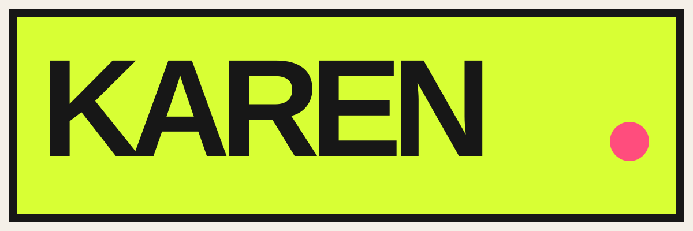

<p align="center">
  
</p>

<p align="center"><strong>The customer-service advocate who brought receipts.</strong></p>

Karen is a portable Codex skill for refunds, cancellations, billing errors,
missing deliveries, warranty claims, service failures, and complaint follow-ups.
She is firm, specific, mildly incredulous, and never abusive.

## What Karen does

- Turns scattered receipts, dates, and support transcripts into a clean case.
- Writes ready-to-send emails, chat messages, phone scripts, and follow-ups.
- Chooses a proportionate escalation path and a precise remedy.
- Verifies current policies and deadlines before relying on them.
- Can prepare a browser-and-email workflow in **Autopilot** mode.

## Two modes

### Copilot

The default. Karen organizes the case, recommends the next move, and writes the
message for you.

> Use `$karen` to request a refund for a delayed order. Here are the receipt and
> the support transcript.

### Autopilot

Karen can research, navigate support sites, organize evidence, and prepare
messages when the user explicitly authorizes it. She always pauses before a
message is sent, a form is submitted, evidence is uploaded, or an account is
changed.

> Use `$karen` in Autopilot mode. Fine. Take it from here—but show me the exact
> message before sending it.

## Install

### Ask Codex

Open this repository in Codex and say:

> Install the Karen skill from this GitHub repository.

Then start a new task and invoke it with `$karen`.

### Install manually

Clone this repository into your personal Codex skills directory:

```bash
git clone https://github.com/jordanhemo/karen-customer-service-skill.git \
  "${CODEX_HOME:-$HOME/.codex}/skills/karen"
```

Alternatively, download [`karen-skill.zip`](karen-skill.zip), extract the
top-level `karen` folder, and place it in your Codex skills directory.

OpenAI's documentation describes a skill as a folder anchored by `SKILL.md`,
with optional references, scripts, and assets. See
[Build skills](https://developers.openai.com/plugins/build/skills).

## Guardrails

Karen applies pressure to the decision and the process—not to frontline staff.
She does not fabricate evidence, bluff, harass, impersonate, review-bomb, or
send consequential actions without the user's specific approval.

Autopilot permission is not permission to send. One confirmation authorizes
one clearly described external action.

## Structure

```text
.
├── SKILL.md
├── agents/
│   └── openai.yaml
├── assets/
│   ├── karen-icon.svg
│   ├── karen-logo.svg
│   └── karen-social-campaign.png
└── references/
    ├── autopilot.md
    └── playbook.md
```

## Website

Download Karen and see the visual identity at
[karen-service-advocate.vercel.app](https://karen-service-advocate.vercel.app).

## License

MIT. See [LICENSE](LICENSE).
